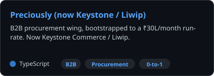
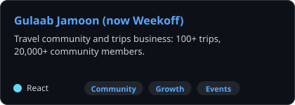
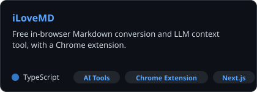
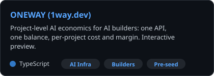

<div align="center">

<!-- HERO REVEAL - Animated Dot-Matrix Portrait -->


<br>

<!-- DYNAMIC TYPEWRITER BANNER -->
<a href="https://github.com/ChawlaBhai">
  
</a>

<br>

<!-- SOCIALS HUD -->
<a href="https://linkedin.com/in/13sahajchawla"></a>
<a href="mailto:sahajsadhu@gmail.com"></a>
<a href="https://x.com/13SahajChawla"></a>
<a href="https://sahaj.ilovemd.online"></a>
<a href="https://github.com/ChawlaBhai"></a>


</div>

---

## `~/` whoami

```console
$ chawla --profile --fast
```

Hi, I'm **Sahaj Chawla**. I'm building **[ONEWAY](https://1way.dev)**, a workspace that shows AI builders the real cost and margin of every AI product they ship. Before this I co-founded three ventures in travel and B2B procurement, mostly on growth, operations and 0-to-1 execution. I build with AI tools every day and ship fast.

- 🧭 **Building [ONEWAY](https://1way.dev)**: one API, one balance, per-project AI spend and margin. Interactive preview is live; private beta is next.
- ⛺ Co-founded **Gulaab Jamoon → [Weekoff](https://weekoff.in/)** (2022–2026): a travel community with 100+ trips. I led growth and operations.
- 🚀 Co-founded the B2B procurement wing of the same group, now **[Keystone Commerce / Liwip](https://www.liwip.com/)** (2023–2026): bootstrapped to a ₹30L/month run-rate.
- 🧠 Built **[iLoveMD](https://ilovemd.online)**: a free, in-browser Markdown converter for LLM workflows, with a Chrome extension.
- 🏆 Winner (with my team), India Sustainability Startathon 2023. Represented India at ACIYLS 2023, Singapore.

> *Chai-paglu. Generalist at heart, bias to ship fast.*

<br>

<div align="center">

## `~/` toolbox


<br><br>


</div>

---

<div align="center">

## `~/` projects

<table>
<tr>
<td width="50%" align="center">
  <a href="https://www.liwip.com/">
    <picture>
      <source media="(prefers-color-scheme: dark)" srcset="assets/card-PreciousLy-dark.svg">
      <source media="(prefers-color-scheme: light)" srcset="assets/card-PreciousLy-light.svg">
      
    </picture>
  </a>
</td>
<td width="50%" align="center">
  <a href="https://weekoff.in/">
    <picture>
      <source media="(prefers-color-scheme: dark)" srcset="assets/card-GulaabJamoon-dark.svg">
      <source media="(prefers-color-scheme: light)" srcset="assets/card-GulaabJamoon-light.svg">
      
    </picture>
  </a>
</td>
</tr>
<tr>
<td width="50%" align="center">
  <a href="https://ilovemd.online/">
    <picture>
      <source media="(prefers-color-scheme: dark)" srcset="assets/card-ilovemd.online-dark.svg">
      <source media="(prefers-color-scheme: light)" srcset="assets/card-ilovemd.online-light.svg">
      
    </picture>
  </a>
</td>
<td width="50%" align="center">
  <a href="https://1way.dev/">
    <picture>
      <source media="(prefers-color-scheme: dark)" srcset="assets/card-ONEWAY-dark.svg">
      <source media="(prefers-color-scheme: light)" srcset="assets/card-ONEWAY-light.svg">
      
    </picture>
  </a>
</td>
</tr>
</table>

</div>

---

<div align="center">

## `~/` contribution calendar

<!-- 3D Isometric Calendar -->
<picture>
  
</picture>

<br><br>

<!-- Snake eats the contribution graph -->
<picture>
  <source media="(prefers-color-scheme: dark)" srcset="assets/snake-dark.svg">
  <source media="(prefers-color-scheme: light)" srcset="assets/snake.svg">
  
</picture>

</div>

---

<div align="center">

</div>
